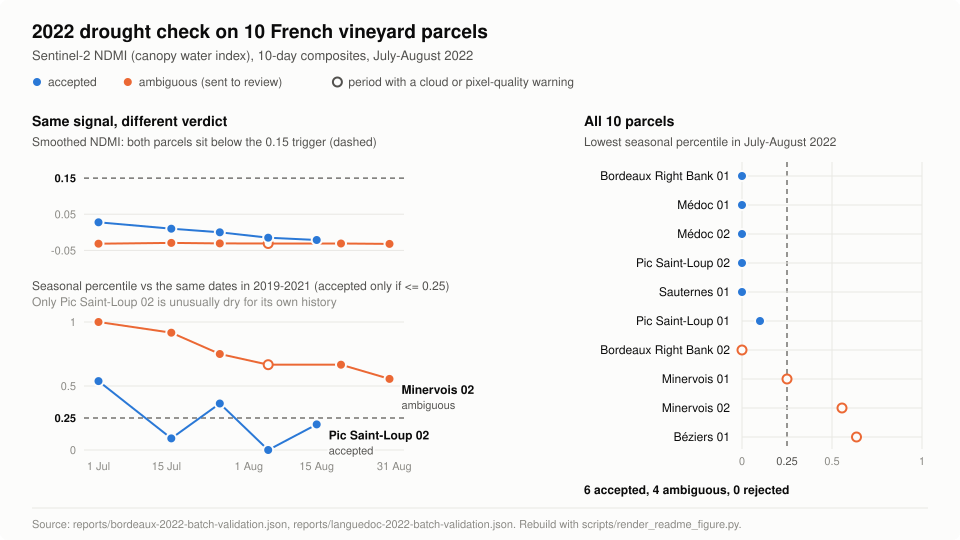
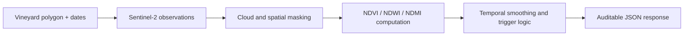

# OrbitRisk

A technical prototype that turns satellite images into an auditable drought-stress record for a vineyard parcel, built for parametric crop insurance pilots.

[](https://github.com/danyballand/OrbitRisk/actions/workflows/ci.yml)




- **Problem:** a parametric insurer needs a drought signal per parcel that it can verify, not a black-box score.
- **Input:** a vineyard parcel polygon (GeoJSON) and a date range.
- **Processing:** free Sentinel-2 satellite images, with clouds and non-vine pixels masked out, are turned into a water-stress index (NDMI) every 10 days and compared with the same dates in earlier years.
- **Output:** a JSON time series with a verdict per parcel (`accepted`, `ambiguous` or `rejected`) and the explicit reasons behind it.

## Overview

OrbitRisk is a FastAPI service and CLI. It is a proof of concept: it has been run on 10 real French vineyard parcels for the July-August 2022 drought, it is not used in production, and it has no customers.

The design choice that matters most is that the engine prefers saying "not sure" to overclaiming. A parcel is accepted only if its water-stress index is low in absolute terms, low compared with that parcel's own history, and backed by enough clean pixels. Anything else is flagged for review with a named reason.

## Why I built it

Parametric insurance pays out when an index crosses a threshold, so the index has to be defensible. Two problems make that hard with satellite data on vineyards:

- **Basis risk.** A naive average over a parcel mixes vine pixels with roads, hedges, roofs and bare soil, so the index can move for reasons unrelated to the crop.
- **Auditability.** An actuary or a reinsurer needs to see why a trigger fired: which dates, how many usable pixels, how cloudy, compared with what baseline.

OrbitRisk explores whether free Sentinel-2 data plus deterministic, documented rules can produce a signal that holds up to that review, before any machine-learning model is justified. The reasoning is recorded in the [architecture decision records](docs/adr/).

## How it works



1. The parcel is projected onto a fixed 10 m grid. A negative edge buffer and, when available, the official French parcel register (IGN RPG) crop outline remove non-vine pixels.
2. Sentinel-2 L2A scenes are loaded from Microsoft Planetary Computer. Cloud, shadow and snow pixels are excluded using the scene classification layer.
3. Vegetation and moisture indices are computed per pixel and aggregated into 10-day composites.
4. NDMI is smoothed (EMA) and compared with observations within 20 days of the same date in previous years (seasonal percentile).
5. A deterministic classifier returns `accepted`, `ambiguous` or `rejected` with reasons such as `seasonal_percentile_not_low` or `quality_warnings_require_review`.

More detail: [docs/ARCHITECTURE.md](docs/ARCHITECTURE.md).

## Results at a glance

July-August 2022 run on 10 vineyard parcels taken from the public IGN RPG 2023 register (5 around Bordeaux, 5 in Languedoc). Figures come from [reports/bordeaux-2022-batch-validation.md](reports/bordeaux-2022-batch-validation.md) and [reports/languedoc-2022-batch-validation.md](reports/languedoc-2022-batch-validation.md).

| | Parcels | What it means |
| --- | ---: | --- |
| Analysed | 10 | All 10 showed an absolute NDMI trigger (smoothed NDMI below 0.15 for 2 periods) |
| Accepted | 6 | Trigger present, unusually dry versus the parcel's own 2019-2021 history, no quality warning |
| Ambiguous | 4 | Trigger present, but at least one check failed, so the result goes to review |
| Rejected | 0 | No parcel hit a hard failure (for example fewer than 20 valid pixels, no baseline, or every period clouded out) |

Why the 4 ambiguous parcels were not reported as drought:

| Parcel | Lowest seasonal percentile | Reason kept ambiguous |
| --- | ---: | --- |
| Bordeaux Right Bank 02 | 0.00 | One target period flagged for high cloud and low clear fraction |
| Minervois 01 | 0.25 | One target period flagged for cloud; usable pixels dropped to 121 |
| Minervois 02 | 0.56 | Low NDMI is normal for this parcel at this time of year; one cloudy period |
| Béziers 01 | 0.64 | Not dry for its own history; final August composite was 95% cloud with 127 valid pixels |

**Example of an avoided false positive.** Minervois 02 has a smoothed NDMI around -0.03 for the whole window, which is lower than the accepted Pic Saint-Loup 02 parcel and well under the 0.15 trigger. A fixed-threshold rule would have flagged it. Its seasonal percentile never drops below 0.56, so compared with its own 2019-2021 observations it was not unusually dry, and OrbitRisk keeps it ambiguous (left panel of the figure above).

A separate mask benchmark on one parcel (Bordeaux Right Bank 01) compared the raw parcel average with the RPG crop outline. The outline covered 87% of the analysed pixels; masking out the rest reduced mean valid pixels per period from 3,341 to 2,606, which was still enough for the drought signal, and the benchmark rated the crop mask `improved` ([report](reports/rpg-2023-first-real-mask-benchmark.md)).

Full write-up: [docs/2022_DROUGHT_VALIDATION_REPORT.md](docs/2022_DROUGHT_VALIDATION_REPORT.md).

## Example output

Abridged from [demo/mga_pilot_2022/outputs/worst_failure_summary.json](demo/mga_pilot_2022/outputs/worst_failure_summary.json) (Béziers 01). Values are unchanged; only some fields and five of the six periods are omitted.

```json
{
  "aoi_id": "FR_RPG23_BEZIERS_01",
  "classification": "ambiguous",
  "confidence": 0.7066368421052631,
  "detected": true,
  "trigger": "ndmi_ema_below_0.15_for_2_periods",
  "reasons": [
    "seasonal_percentile_not_low",
    "quality_warnings_require_review"
  ],
  "quality": {
    "baseline_supported_period_count": 6,
    "mean_cloud_pct": 15.842396880771597,
    "min_baseline_percentile": 0.6363636363636364,
    "min_valid_pixel_count": 127,
    "quality_flag_counts": {
      "high_cloud_fraction": 1,
      "low_clear_fraction": 1
    },
    "target_period_count": 6
  },
  "ndmi_periods": [
    {
      "period": "2022-08-24/2022-08-31",
      "ndmi_mean": 0.2042471021413803,
      "ndmi_ema": 0.17888177931731003,
      "ndmi_baseline_percentile": 1.0,
      "cloud_pct": 95.05438128462959,
      "valid_pixel_count": 127,
      "quality": "poor",
      "quality_flags": ["low_clear_fraction", "high_cloud_fraction"]
    }
  ]
}
```

The accepted counterpart is [strongest_success_summary.json](demo/mga_pilot_2022/outputs/strongest_success_summary.json) (Pic Saint-Loup 02).

## Quickstart

Requires Python 3.11+ and a GDAL runtime for `rasterio`.

```bash
python -m venv .venv && source .venv/bin/activate
pip install -e ".[dev]"
pytest
uvicorn orbitrisk.api.main:app --reload
```

Then `curl http://127.0.0.1:8000/health`. The default `POST /v1/risk/quote` endpoint validates the request and returns a deterministic dry-run response with placeholder values. Live Sentinel-2 runs, CLI commands and API keys are covered in [docs/DEVELOPMENT.md](docs/DEVELOPMENT.md).

## Validation and limitations

- **Resolution.** Sentinel-2 pixels are 10 m. That is enough for a parcel-level signal on reasonably large parcels, not for separating vine rows from the soil between them. Many parcel edges contain mixed pixels (vines plus roads, hedges, roofs or bare soil).
- **Clouds.** Cloudy periods reduce the number of usable pixels. OrbitRisk flags them instead of filling them in, which is why all 4 ambiguous parcels carry a quality warning.
- **No ground truth.** The repository contains no insurance claims, yield losses or field observations. "Accepted" means the parcel passed the documented rules during a known drought, not that a loss was confirmed. There is no supervised model for the same reason.
- **One event.** Validation covers a single drought window (July-August 2022). No non-drought window has been run yet, so the false-positive rate is unknown.
- **Small sample.** 10 parcels in two regions. The mask benchmark covers one parcel.
- **Prototype status.** Not deployed, not used by any insurer. The dry-run endpoint returns placeholder values; live runs use Planetary Computer.

Calibration choices are explained in [docs/NDMI_TRIGGER_CALIBRATION.md](docs/NDMI_TRIGGER_CALIBRATION.md).

## Repository structure

```text
src/orbitrisk/     FastAPI app, CLI, geospatial processing, time series, classifiers
tests/             Unit tests (pytest), run in CI with Ruff
reports/           Tracked validation and mask benchmark outputs (JSON, Markdown, SVG)
demo/mga_pilot_2022/  Offline demo pack: requests, response summaries, reports, charts
data/              Public RPG 2023 vineyard parcels and crop outlines (GeoJSON)
examples/          AOI batch manifests used by the CLI
docs/              Validation report, architecture, API contract, ADRs, roadmap
scripts/           Data-pack builder and README figure renderer
```

## Further documentation

- [2022 drought validation report](docs/2022_DROUGHT_VALIDATION_REPORT.md)
- [Development guide and full CLI reference](docs/DEVELOPMENT.md)
- [Architecture](docs/ARCHITECTURE.md) and [API contract](docs/API_CONTRACT.md)
- [First real crop-mask benchmark](docs/FIRST_REAL_MASK_BENCHMARK.md)
- [NDMI trigger calibration](docs/NDMI_TRIGGER_CALIBRATION.md)
- [Architecture decision records](docs/adr/)
- [Demo pack](demo/mga_pilot_2022/README.md)
- [Project status](docs/POC_STATUS.md) and [roadmap](docs/ROADMAP.md)
